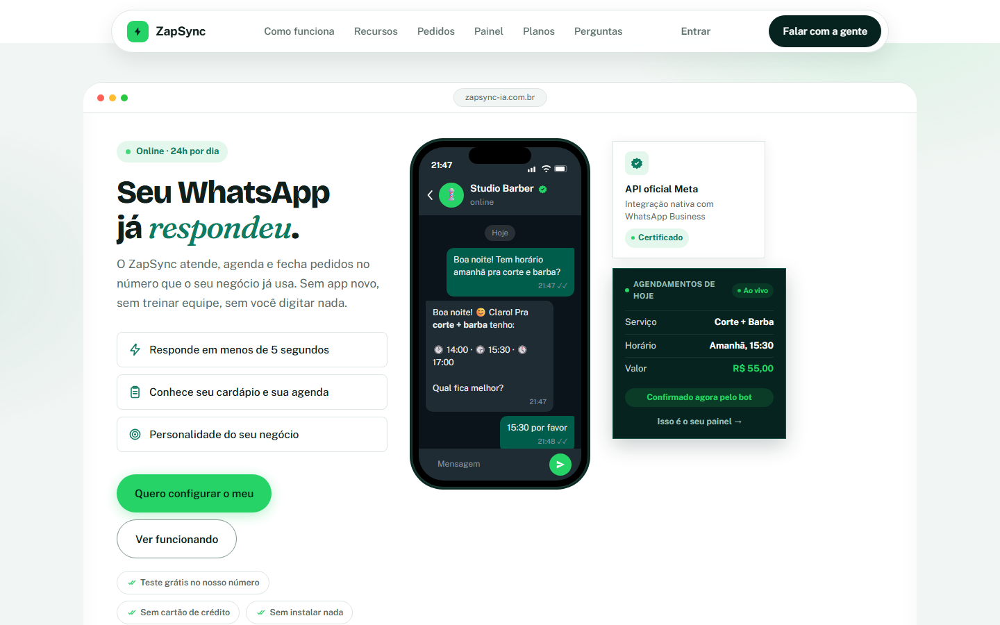
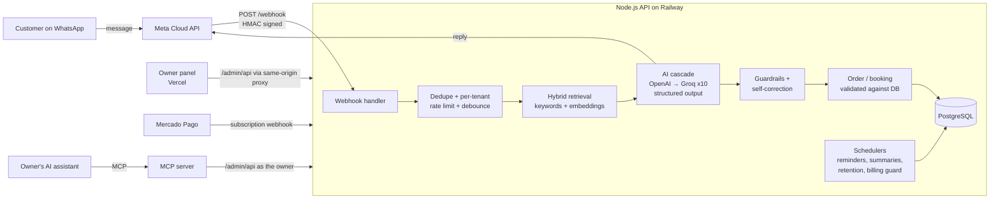
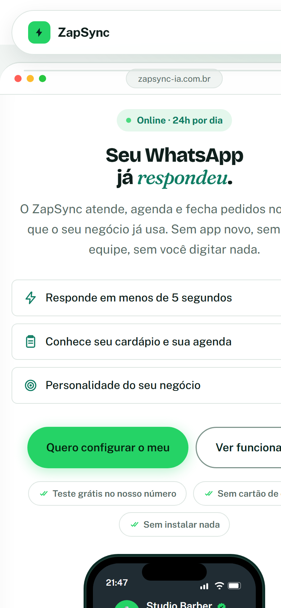
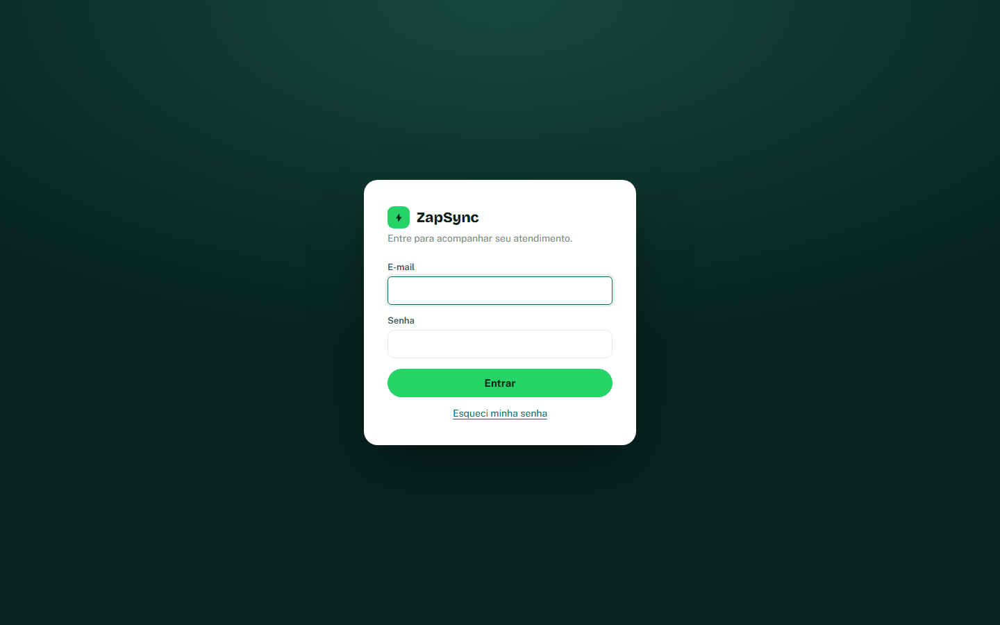

# ZapSync · AI customer service on WhatsApp

 

**ZapSync is a multi-tenant SaaS I designed, built and run on my own.** Small businesses in Brazil (restaurants, pizzerias, barbershops, clinics) connect their WhatsApp number and an AI assistant answers customers 24/7, takes orders, books appointments and hands the conversation to a human when needed. Owners manage everything in a web panel, and the whole lifecycle (sign-up, WhatsApp connection, billing, suspension) is self-service.

**Live:** [zapsync-ia.com.br](https://www.zapsync-ia.com.br) · **Source code:** private (it is a commercial product). This repository is a public showcase: architecture, engineering decisions and a few representative code excerpts with tests. I am happy to walk through the private code in an interview.

## At a glance

| | |
|---|---|
| **Role** | Solo: product, backend, frontend, infrastructure, billing integration, customer onboarding and support |
| **Backend** | Node.js + Express, PostgreSQL, ~8,500 lines across 25 modules, plus an MCP server and an eval set |
| **AI** | Structured outputs, hybrid RAG (keywords + embeddings), output guardrails with self-correction, multimodal input (Whisper, vision), evals against the live model, MCP server |
| **Frontend** | Vanilla HTML/CSS/JS, no build step, ~5,400 lines (marketing site, owner panel, operator panel) |
| **Tests** | 158 automated tests against a real PostgreSQL database, run by GitHub Actions on every push |
| **Integrations** | Meta WhatsApp Cloud API (official), OpenAI, Groq, Mercado Pago subscriptions, Google Maps, ViaCEP, SMTP |
| **Hosting** | Railway (API + Postgres), Vercel (site and panel) |

## What it does

- **Natural conversation on WhatsApp**, no numbered menus. The AI knows the business's menu or services, opening hours and tone of voice.
- **Order and appointment detection.** The AI extracts structured orders (items, sizes, pizza flavors, options, quantities) and bookings. Double booking is prevented at the database level with a unique index, not only in application code.
- **Automations:** appointment reminders, stuck-order alerts, post-delivery follow-up with a rating, daily summary to the owner.
- **Human handoff:** the owner can pause the bot for one conversation and take over.
- **Owner panel:** dashboard, orders, products (with spreadsheet import), appointments, CRM, reports, settings and an AI diagnostics page.
- **Self-service onboarding:** invitation-gated sign-up and WhatsApp connection through Meta's **Embedded Signup**, so no one on my side has to touch the customer's Business Manager.
- **Recurring billing** with Mercado Pago subscriptions: payment confirmation creates the sign-up invite automatically; failed payments trigger a grace period and then automatic suspension (no data is deleted); paying again reactivates instantly.
- **MCP server** so owners can run the business by talking to an AI assistant (Claude Desktop, Claude Code): "how many orders today?", "the Heineken ran out, take it off the menu", "what did the bot tell this customer?".
- **Operator panel** to see every tenant, subscription status and connection state, plus an audit log of sensitive actions.
- **LGPD (Brazilian GDPR):** conversation history is purged automatically after a configurable retention period.

## Architecture

More diagrams (message lifecycle, billing lifecycle, tenant isolation) in [docs/architecture.en.md](docs/architecture.en.md).

## AI engineering

The AI is the product, so most of the engineering effort sits around the model, not inside the prompt.

- **Message pipeline.** Signature check and dedupe, a 2-second debounce that merges messages typed in quick succession into one turn, a per-conversation queue (never two model calls at once for the same chat), audio to text with Whisper, images described by a vision model, then context assembly, the model call, guardrails and validation.
- **Structured outputs.** The model returns one JSON object with a strict schema (`reply`, `event_type`, `order`, `appointment`, `cancellation`). OpenAI enforces the schema; on Groq fallbacks the JSON is requested by instruction and parsed defensively.
- **Hybrid RAG.** The menu is retrieved from PostgreSQL on every message. Keyword search (accents, plurals, synonyms) comes first; semantic search with `text-embedding-3-small` and cosine similarity adds what keywords miss ("something to quench my thirst" → soft drinks). Only new or edited items are re-embedded, and it falls back to keyword-only if the embeddings API is down. [hybrid-search.js](snippets/hybrid-search.js)
- **Guardrails with self-correction.** Three checks catch the failure modes seen in production: the bot claiming an item that exists is unavailable, ignoring the item it was given, or re-asking something it already confirmed. When one fires, the backend calls the model again with a corrective instruction and keeps the new reply only if it passes the same checks.
- **The model decides what, the database decides how much.** Prices are recomputed from the catalog, a quantity above 1 is reset to 1 when the customer never said a number, and orders are blocked when the store is closed or the POS integration is offline.
- **Evals.** 12 real conversation turns with expected results (order fields, quantities, cancellations, out-of-menu items, prompt injection, relative dates) run against the live model before any prompt or model change, with repetitions and a minimum pass rate. The scorer is deterministic, with no LLM-as-judge. [eval-scorer.js](snippets/eval-scorer.js)
- **MCP server.** 16 tools (orders, bookings, menu availability and prices, CRM, conversations, pausing the bot, reports, AI health). It talks to the panel API logged in as the owner instead of touching the database, so it inherits tenant isolation, validation and audit logging. Write tools are flagged `destructiveHint` so the assistant asks before acting.

## Engineering highlights

| Problem | What I did | Code |
|---|---|---|
| One slow provider could hang requests and drain the connection pool | Every outbound call has a hard timeout (native `AbortSignal.timeout`) | [fetch-timeout.js](snippets/fetch-timeout.js) |
| Anyone who found the webhook URL could forge customer messages | HMAC-SHA256 validation over the raw body with constant-time comparison | [verify-meta-signature.js](snippets/verify-meta-signature.js) |
| Meta re-delivers webhooks, so the bot sometimes answered twice | Message-id deduplication with TTL and sweeping | [dedupe.js](snippets/dedupe.js) |
| AI providers go down or hit rate limits; a customer must never be left without a reply | Ordered 11-step cascade across providers, accounts and model sizes, with per-provider stats in the panel | [ai-cascade.js](snippets/ai-cascade.js) |
| Keyword search found nothing for "something to drink", so the bot told customers it was "having trouble" | Hybrid retrieval: embeddings add what keyword search misses, re-embedding only changed items | [hybrid-search.js](snippets/hybrid-search.js) |
| "It looked fine in two test chats" is not a release criterion for a prompt change | Eval set against the live model with a deterministic scorer and a minimum pass rate | [eval-scorer.js](snippets/eval-scorer.js) |
| A logged-in owner must never see another business's data | `business_id` only from the signed session, every query scoped, same 404 for "missing" and "not yours", cross-tenant tests | [tenant-scope.js](snippets/tenant-scope.js) |
| Third-party cookies are blocked more and more by browsers | Panel calls the API through a Vercel same-origin proxy, so the session cookie is first-party (`SameSite=Lax`) | [docs/decisions.en.md](docs/decisions.en.md) |

All excerpts are simplified from production code and covered by tests in [snippets/test](snippets/test) (`npm test`).

## Security

- Passwords hashed with `scrypt` and per-user salt; login brute-force lock (8 attempts per IP + e-mail in 15 min) with identical error messages.
- HMAC-signed session cookie (`HttpOnly`, `Secure`, `SameSite=Lax`, 12 h), re-validated against the database on every request, so changing the password or disabling a user ends sessions immediately.
- Invite and password-reset tokens stored only as hashes, single use, short expiry.
- Both webhooks (Meta and Mercado Pago) validate signatures.
- Security headers (HSTS, CSP, frame and referrer policies), `Cache-Control: no-store` on the admin API, per-route rate limits.
- Phone numbers masked in logs; sensitive request bodies never logged.

## Testing and operations

- `node --test` suite with 158 cases running serially against a real PostgreSQL: tenant isolation, sign-up races, password recovery, catalog and pizza flavors, time zones in scheduling, AI order extraction, hybrid search (with a deterministic fake embedder), the MCP server end to end, and regression cases taken from real production logs.
- **CI on GitHub Actions:** every push spins up PostgreSQL 17 and runs the whole suite; the evals against the live model run on demand in the same workflow and upload their results as an artifact.
- Additive, idempotent migrations run on boot, so a deploy never needs manual database steps.
- CLI scripts for operations: create invites, grant operator access, create billing plans, bulk-import menus from other POS systems.

## What I learned

- **Reliability comes from boring details:** timeouts, idempotency, retries with fallbacks and deduplication prevented more incidents than any feature.
- **Support experience shapes the product.** Years of N2/N3 support in food-service software (fiscal documents, card payments, integrations) taught me which failures hurt a restaurant at 8 p.m. on a Friday, and the product is built around avoiding them.
- **Self-service matters for a solo founder.** Embedded Signup and automated billing turned onboarding from a manual call into a flow the customer completes alone.

## Screenshots

| Mobile | Owner panel login |
|---|---|
|  |  |

Full landing page: [docs/img/site-full.png](docs/img/site-full.png)

## About me

I'm **Abner Duarte**, from Brazil: technical support analyst (N2/N3 and implementation) moving into cloud support and software engineering. I speak English fluently and I'm studying for AWS certifications.
GitHub: [@darkslipx](https://github.com/darkslipx)

---

The ZapSync product and its source code are proprietary. The code excerpts in [`snippets/`](snippets) are released under the MIT license.
