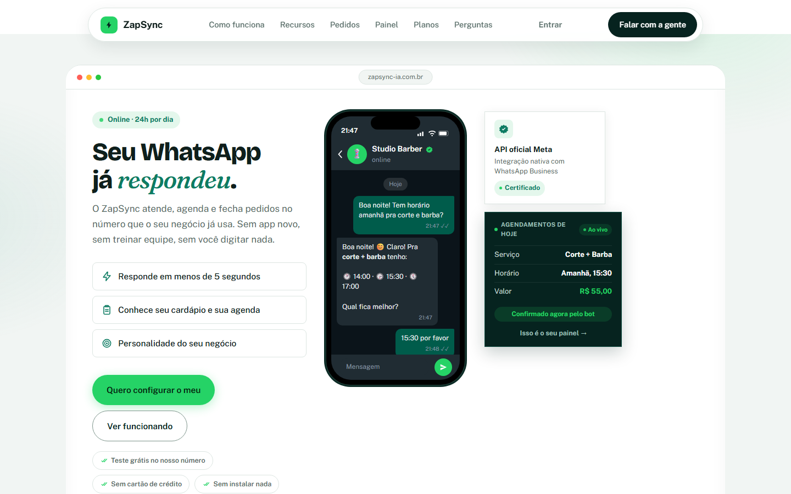

# ZapSync · Atendimento com IA no WhatsApp

> 🇺🇸 [Read in English](README.md)

**O ZapSync é um SaaS multi-tenant que eu projetei, desenvolvi e opero sozinho.** Pequenos negócios (restaurantes, pizzarias, barbearias, clínicas) conectam o número de WhatsApp e uma IA atende os clientes 24 horas, fecha pedidos, marca horários e passa a conversa para um humano quando precisa. O dono gerencia tudo num painel web, e o ciclo inteiro (cadastro, conexão do WhatsApp, cobrança, suspensão) é self-service.

**No ar:** [zapsync-ia.com.br](https://www.zapsync-ia.com.br) · **Código-fonte:** privado (é um produto comercial). Este repositório é uma vitrine pública: arquitetura, decisões de engenharia e alguns trechos de código representativos, com testes. Posso mostrar o código privado numa entrevista.

## Resumo

| | |
|---|---|
| **Papel** | Tudo: produto, backend, frontend, infraestrutura, integração de pagamento, onboarding e suporte aos clientes |
| **Backend** | Node.js + Express, PostgreSQL, cerca de 8.500 linhas em 25 módulos, mais um servidor MCP e um conjunto de evals |
| **IA** | Saída estruturada, RAG híbrido (palavra-chave + embeddings), guardrails com auto-correção, entrada multimodal (Whisper e visão), evals contra o modelo real e servidor MCP |
| **Frontend** | HTML/CSS/JS puro, sem build, cerca de 5.400 linhas (site, painel do dono, painel do operador) |
| **Testes** | 158 testes automatizados contra um PostgreSQL real, rodados pelo GitHub Actions a cada push |
| **Integrações** | API oficial do WhatsApp (Meta Cloud API), OpenAI, Groq, assinaturas Mercado Pago, Google Maps, ViaCEP, SMTP |
| **Hospedagem** | Railway (API + Postgres) e Vercel (site e painel) |

## O que faz

- **Conversa natural no WhatsApp**, sem menu numerado. A IA conhece o cardápio ou os serviços, o horário e o jeito de falar do negócio.
- **Detecção de pedido e agendamento**, com itens, tamanhos, sabores de pizza, opções e quantidades. Conflito de horário é barrado no banco (índice único), não só no código.
- **Automações:** lembrete de agendamento, alerta de pedido travado, follow-up pós-entrega com avaliação, resumo diário para o dono.
- **Atendimento humano:** o dono pausa o bot numa conversa e assume.
- **Painel do dono:** dashboard, pedidos, produtos (com importação de planilha), agenda, CRM, relatórios, configurações e diagnóstico da IA.
- **Onboarding self-service:** cadastro por convite e conexão do WhatsApp pelo **Embedded Signup** da Meta.
- **Cobrança recorrente** com Mercado Pago: pagamento confirmado gera o convite; falha de pagamento abre período de tolerância e depois suspende sem apagar dados; pagou, reativa na hora.
- **Servidor MCP** para o dono operar o negócio conversando com um assistente de IA (Claude Desktop, Claude Code): "quantos pedidos hoje?", "acabou a Heineken, tira do cardápio", "o que o bot respondeu pra esse cliente?".
- **Painel do operador** com todos os negócios e **log de auditoria** das ações sensíveis.
- **LGPD:** histórico de conversa expurgado automaticamente após o prazo de retenção.

## Arquitetura e decisões

- Diagramas: [docs/architecture.md](docs/architecture.md)
- Decisões de engenharia e por quê: [docs/decisions.md](docs/decisions.md)
- Trechos de código com testes: [snippets/](snippets) (`npm test`)

## Engenharia de IA

A IA é o produto, então a maior parte da engenharia está em volta do modelo, não dentro do prompt.

- **Pipeline da mensagem.** Validação de assinatura e deduplicação, espera de 2 segundos que junta mensagens digitadas em sequência num turno só, fila por conversa (nunca duas chamadas ao modelo ao mesmo tempo no mesmo chat), áudio para texto com Whisper, imagem descrita por modelo de visão, depois montagem do contexto, chamada ao modelo, guardrails e validação.
- **Saída estruturada.** O modelo devolve um JSON com schema estrito (`reply`, `event_type`, `order`, `appointment`, `cancellation`). A OpenAI impõe o schema; nos fallbacks do Groq o JSON é pedido por instrução e lido de forma tolerante.
- **RAG híbrido.** O cardápio é recuperado do PostgreSQL a cada mensagem. A busca por palavra (acento, plural, sinônimos) vem primeiro, e a busca semântica com `text-embedding-3-small` e similaridade de cosseno acrescenta o que ela não acha ("algo pra matar a sede" → refrigerantes). Só item novo ou editado é embedado de novo, e se a API de embeddings cair fica só a busca por palavra. [hybrid-search.js](snippets/hybrid-search.js)
- **Guardrails com auto-correção.** Três verificações pegam os erros vistos em produção: o bot dizer que não tem um item que existe, ignorar o item que recebeu ou perguntar de novo algo que já confirmou. Quando uma dispara, o backend chama o modelo de novo com uma instrução corretiva e só usa a nova resposta se ela passar nas mesmas verificações.
- **O modelo decide o quê, o banco decide quanto.** O preço é recalculado pelo cardápio, quantidade acima de 1 volta para 1 se o cliente não falou número, e o pedido é bloqueado com a loja fechada ou o PDV fora do ar.
- **Evals.** 12 turnos de conversa real com o resultado esperado (campos do pedido, quantidade, cancelamento, item fora do cardápio, injeção de prompt, data relativa), rodados contra o modelo de verdade antes de qualquer troca de prompt ou modelo, com repetições e taxa mínima de acerto. O avaliador é determinístico, sem LLM como juiz. [eval-scorer.js](snippets/eval-scorer.js)
- **Servidor MCP.** 16 ferramentas (pedidos, agenda, disponibilidade e preço do cardápio, CRM, conversas, pausar o bot, relatórios, saúde da IA). Ele usa a API do painel logado como o dono, sem acesso direto ao banco, e por isso herda o isolamento entre negócios, a validação e a auditoria. Ferramentas de escrita são marcadas com `destructiveHint`, para o assistente pedir confirmação antes.
- **CI no GitHub Actions:** a cada push sobe um PostgreSQL 17 e roda a suíte inteira; os evals contra o modelo real rodam sob demanda no mesmo workflow.

## Destaques de engenharia

- **Timeout em toda chamada externa**, para um provedor lento não travar o serviço.
- **Validação HMAC do webhook da Meta** sobre o corpo cru, com comparação em tempo constante.
- **Deduplicação** dos reenvios do webhook, que faziam o bot responder duas vezes.
- **Cascata de IA com 11 tentativas** (OpenAI e várias contas Groq, modelo grande e pequeno), para o cliente nunca ficar sem resposta.
- **Isolamento entre negócios:** o `business_id` vem só da sessão assinada, e existem testes tentando atravessar de um negócio para outro.
- **Proxy same-origin na Vercel**, para o cookie do painel ser first-party e não sofrer com o bloqueio de cookies de terceiros.

## O que aprendi

- Confiabilidade vem de detalhes chatos: timeout, idempotência, fallback e deduplicação evitaram mais incidentes do que qualquer funcionalidade.
- A experiência de suporte N2/N3 em sistemas de food service (fiscal, TEF, integrações) guiou o produto: eu sabia o que dói num restaurante numa sexta às 20h.
- Para quem opera sozinho, self-service é essencial: Embedded Signup e cobrança automática tiraram o onboarding do manual.

## Sobre mim

Sou **Abner Duarte**, analista de suporte técnico (N2/N3 e implantação) em transição para cloud support e desenvolvimento. Inglês fluente, estudando para as certificações AWS.
GitHub: [@darkslipx](https://github.com/darkslipx)

---

O produto ZapSync e seu código-fonte são proprietários. Os trechos em [`snippets/`](snippets) estão sob licença MIT.
