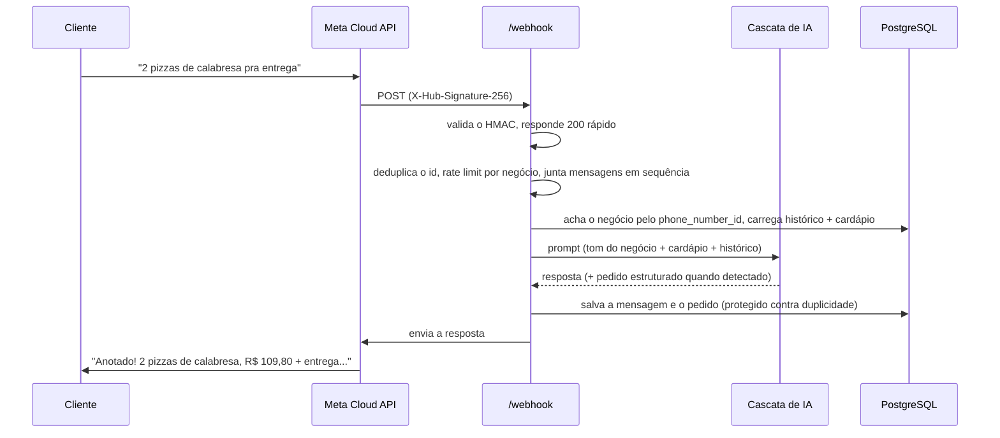
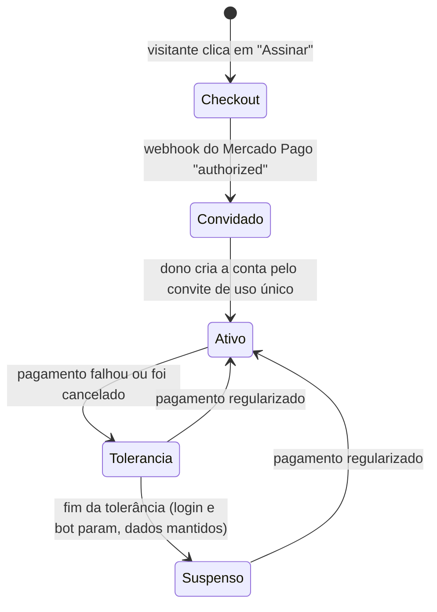
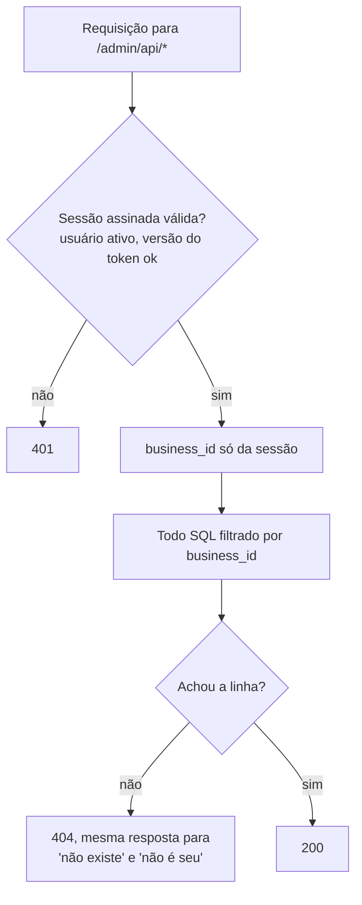

# Arquitetura

 

## Componentes

| Componente | Onde | Responsabilidade |
|---|---|---|
| Site + painel do dono + painel do operador | Vercel (estático, sem build) | Cadastro, conexão do WhatsApp, gestão do dia a dia |
| API | Railway, Node.js + Express | Processamento do webhook, IA, API do painel, cobrança, agendadores |
| Banco de dados | PostgreSQL no Railway | Negócios, usuários, mensagens, pedidos, agendamentos, cardápio, log de auditoria |
| WhatsApp | Meta Cloud API (oficial) | Receber e enviar mensagens, mídia, Embedded Signup |
| IA | OpenAI, Groq | Respostas, extração de pedido e agendamento, transcrição de áudio |
| Cobrança | Assinaturas do Mercado Pago | Checkout hospedado, cobrança recorrente, webhooks de status |

## Ciclo da mensagem

Se todas as tentativas de IA falharem, o cliente ainda recebe uma resposta pronta e segura, para ninguém ficar no vácuo.

## Ciclo da cobrança

## Isolamento entre negócios

## Tarefas agendadas

| Tarefa | O que faz |
|---|---|
| Lembrete de agendamento | Envia um template de WhatsApp antes de cada horário marcado |
| Alerta de pedido travado | Avisa o dono sobre pedidos pendentes há tempo demais |
| Follow-up pós-entrega | Pede uma avaliação ao cliente |
| Resumo diário | Manda ao dono os números do dia |
| Retenção (LGPD) | Apaga o histórico de conversa mais antigo que o prazo de retenção |
| Guarda da assinatura | Move os negócios entre ativo, tolerância e suspenso |
